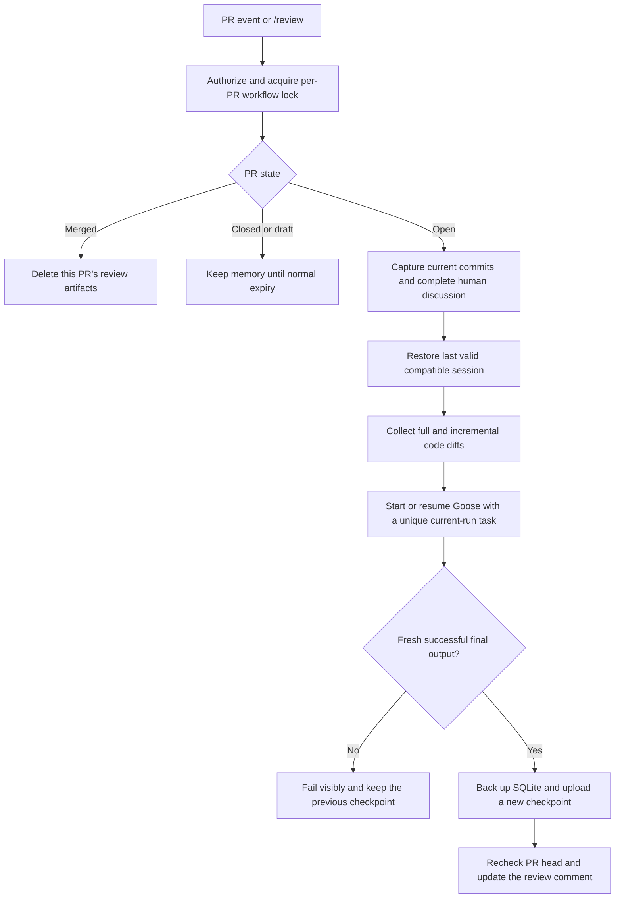

# Agentic PR review with a saved Goose session

This is the Buildplace AI PR review flow adapted for RoadbookNavi, extended with
one persistent Goose session per PR. It investigates code without running project
scripts or tests, updates one English review comment, and never approves or merges.
Explicit `/review` comments additionally receive a separate, linked response.

## Enable the test environment

1. Add the repository Actions secret **`OPENROUTER_API_KEY`**.
2. Commit these files when ready and put them on the repository's **default branch**.
   Merely adding the files to an unmerged PR does not activate the privileged worker.
   RoadbookNavi's default branch is `dev`.
3. Allow the pinned checkout/artifact Actions and the token permissions below.
4. Ensure repository/organization artifact retention permits the configured 90 days.
5. Open a non-draft PR from this repository, comment `/review` on an existing one,
   or run **AI PR Review** manually on the default branch with its PR number.

The worker always loads automation from the default branch, then pins that exact
automation SHA for all its jobs. The PR head is checked out separately as read-only
review data. No secret or production configuration is included in these files.

## Fixed free model

The only allowed requested model is:

```text
nvidia/nemotron-3-ultra-550b-a55b:free
```

Before each investigation the host checks OpenRouter's public model catalog for
zero prices and tool support. Requests also cap provider prompt/completion prices
at zero. A different model ID, changed prices, unavailable free capacity or an API
rate limit fails the run; there is no paid-model or free-router fallback. Goose's
automatic session naming is disabled to avoid unrelated naming calls.

Free access can be rate-limited; it does not guarantee continuous availability.
This is deliberately a test environment. NVIDIA's free endpoint may log submitted
content; use it only for code/data suitable for that endpoint's terms. Session
artifacts contain conversation and code excerpts and are downloadable by users
with repository read access. Never place credentials in PR descriptions/comments
or fixtures intended for model review.

## Triggers and access

- Opened/reopened/ready PRs, pushes (`synchronize`) and edited PR metadata.
- Human PR/inline comments or submitted/edited reviews **starting with `/review`**.
- `/review` or `/review focus on error handling` (up to 1,000 focus characters).
- Manual workflow dispatch on the default branch with a PR number.
- Merge closure for memory cleanup, including merges performed by bots.

Review triggers require effective repository write, maintain or admin permission.
Fork, draft, closed and bot-triggered reviews are skipped. Own bot comments do not
trigger a model call. Closing without merging retains the session until expiry;
reopening can continue it.

Initial PR reviews and push reviews remain automatic. Ordinary human comments do
not start a review and do not receive unsolicited replies; they are still included
as evidence in the next investigation. Use `/review it should stay there` to ask
the agent to address an objection or explanation, not only a question. Bare
`/review` requests a new review with a short direct response. The command must be
at the start of the comment; `/reviewer` is not a command.

Inline review events use `ai-review-discussion.yml`, a minimal listener with no
secrets or write permissions. A successful listener run wakes the privileged
default-branch worker through `workflow_run`. The worker verifies listener path,
event, actor and same-repository PR association, then checks for an unanswered
`/review` command; ambiguous/missing associations
are skipped. The listener never checks out or executes PR code.

## Session lifecycle



The actual code/discussion snapshot is captured after the workflow lock is
acquired. Each follow-up receives both the complete merge-base PR diff and an
additional previous-head-to-current-head diff when the old commit is available.
Force-pushes and base changes are flagged. If an old object is absent, Goose uses
the current complete diff and the saved conversation. Architecture reference data
comes from the reviewed commit's `ARCHITECTURE.md` and `README.md` Git blobs,
without following PR-controlled symlinks on the host.

Human comments, reviews and thread comments are fully paginated. The saved
discussion snapshot identifies new/edited/deleted messages and changed thread
states. Full current discussion remains available. A fresh session can read the
last published own AI review and prior command responses for context; a resumed
session already contains its earlier answers. GraphQL's `github-actions` and
REST's `github-actions[bot]` are recognized only with a Bot author type.

If both code/metadata and human discussion are unchanged, automatic events skip
the model call. Explicit `/review` and manual dispatch always request a new review.

### Successful checkpoints

Each successful run uploads a new immutable artifact named:

```text
ai-review-session-pr-N-run-RUN_ID-attempt-ATTEMPT
```

It contains exactly:

| File              | Purpose                                                                                                               |
| ----------------- | --------------------------------------------------------------------------------------------------------------------- |
| `sessions.db`     | Consistent SQLite backup: conversation, tool outputs, usage ledger and extension state such as todos                  |
| `manifest.json`   | Repository/PR, session ID, checked head/base/merge-base, predecessor, workflow/run and compatibility/hash information |
| `discussion.json` | The discussion state processed by this run                                                                            |
| `result.json`     | This run's validated review                                                                                           |

Restoration checks artifact provenance against this worker's workflow identity,
the PR, archive members, checksums and runtime compatibility. It tries older valid
checkpoints if a newer one is corrupt or incompatible. If none is usable, the run
starts fresh and says so. Image, requested model or session-schema changes invalidate old
checkpoints intentionally. The recipe hash is retained for auditing, but prompt
updates do not discard compatible history. Incompatible extension/storage changes
must bump the session schema. Saved runtime recipe/model/prompt overrides are cleared
while preserving conversation and extension data; the current trusted recipe and
explicit model flags configure the resumed process.

Only the session database is persisted, not Goose's home/configuration, API keys,
Docker credentials or raw stderr. Backups are made after Goose exits using the
SQLite backup API. All connections are closed and the exported database is sealed
in DELETE journal mode, so its directory and upload allowlist contain exactly the
four documented files, without WAL/SHM sidecars. Legacy exports with an empty WAL
and a bounded SHM file can be recovered after the same provenance/checksum checks;
nonempty WALs are rejected rather than silently losing transactions. Checkpoints
are ordered by creation time, not artifact IDs. Host restore/snapshot size limits are enforced independently
from the CLI output and final comment limits.

Goose can compact long history as needed. A saved session is not an unlimited
active context window. Changed files and callers must still be read again.

### Merge cleanup

The workflow lock spans restore, investigation, upload, publication and cleanup.
`queue: max` retains up to 100 pending requests instead of replacing the pending
merge cleanup with a later comment. Each eligible run rechecks the live merged state.
This uses GitHub's documented [concurrency queue option](https://docs.github.com/en/actions/reference/workflows-and-actions/workflow-syntax#concurrency).

A separate cleanup job with `actions: write` deletes all session, result and numeric
diagnostic artifacts for that PR from this trusted worker, including older
versions. It enumerates before deleting, tolerates already missing artifacts and
verifies that no matching trusted artifact remains. Other PRs and other CI artifacts
are untouched. Published PR comments are retained.

The cleanup also runs after a failed review, without a model call or OpenRouter
key. If a PR merges during the investigation, a new checkpoint upload is skipped
when detected and the final cleanup removes any artifacts uploaded during a race.
Closing without merging does not delete memory. The 90-day artifact expiry remains
the fallback for inactive/abandoned PRs.

## Isolation, limits and publication

Preparation and analysis have read permissions; only the separate publisher can
write PR comments. Only the separate cleanup job can delete Actions artifacts.
The model container receives no GitHub token or Docker socket, drops capabilities,
runs as the runner UID/GID, and has a read-only root and repository. It can write
temporary files and its session state. Network access is available for OpenRouter.
Developer shell tools are powerful: recipe instructions are not a technical
command allowlist or a complete defense against prompt injection.

Goose has 15 minutes and 40 turns per execution. The model job has 30 minutes.
The final answer must be a newly accepted `recipe__final_output` from after the
unique current-run prompt, followed by a matching structured assistant answer.
An old successful answer in a resumed history cannot validate a failed new run.
The final output contains `review` and `responses`. Every outstanding `/review`
comment in `reply-targets.json` requires exactly one nonempty response for its
comment ID, including statements/disagreements. Missing, duplicate or unexpected
responses fail the run instead of silently publishing a review without an answer.
This validates coverage and structure, not the semantic quality of the answer.
There can be at most 100 pending commands, with 20–6,000 characters per response.
Markdown must have Findings and Checked and limits sections and fit 50,000
characters; the raw CLI JSON is limited to 64 MB and the final comment to 60,000
characters. The recipe asks for at most eight high-confidence P1/P2 findings, but
host validation does not semantically validate each reported path/line/finding.

Before publication, the publisher rechecks that the PR is open, non-draft and still
on the reviewed head. Late results are not presented as a review of a newer commit.
The saved checkpoint still records the exact actually reviewed commit so the next
run can continue from it. The publisher updates the review summary, then posts
separate PR timeline responses linking to each command (also for inline/review
commands). It rechecks live command bodies and skips edited/deleted commands.
Stable per-command/body markers prevent duplicate replies on retries, including
partial publication failures; ordinary comments are never response targets. An
unchanged checkpoint cannot suppress a still-unanswered command after a failed
publication. An empty review does not establish correctness.

## Costs and diagnostics

The comment displays **Model cost according to Goose, this run**. Goose uses
provider-reported cost when available and its own calculation otherwise. The host
reads only new usage-ledger rows since restoration, including any new recorded
compaction requests. It never re-sums the old conversation as a new run. Missing
cost data is shown as unavailable; a positive recorded cost fails this free-model
test configuration. There is no extra OpenRouter generation-cost API lookup.

Numeric diagnostics have seven-day retention; the separate publication result has
one-day retention; successful full sessions have 90-day retention. Raw provider
errors and conversation logs are not printed/uploaded as diagnostic artifacts.
The session database itself deliberately contains the review conversation.

## Local and CI verification

No dependencies, model calls, secrets or Docker are needed for the offline tests:

```bash
python3 -B -m unittest discover -s .github/ai-review -p 'test_*.py' -v
for script in .github/ai-review/*.sh; do bash -n "$script"; done
```

`ai-review-checks.yml` runs these on changes to the review automation using an
unprivileged `pull_request` workflow. Tests cover completion boundaries, discussion
pagination/deltas, event trust, checkpoint integrity and history/todo preservation,
per-run usage, force-push comparisons and merge-cleanup scope. Regression tests
also zip the entire real WAL-backup directory and restore it, cover legacy WAL
exports, GraphQL Bot identities, `/review` gating, required statement responses,
and separate/idempotent publication with live edited/deleted-command checks.

Actionlint 1.7.12 does not yet recognize GitHub's documented `concurrency.queue`.
When using that version, ignore only its `unexpected key "queue" for "concurrency"`
diagnostic; do not suppress other workflow validation errors.

For a real end-to-end test after activation: open a small internal PR, request a
review, add `/review` followed by a question or objection, push a fix and verify
that the next run continues the same
session. Then merge and verify all PR memory artifacts are removed. A container
smoke test should precede changes to the pinned Goose image.

## Files and origin

The investigation style, isolated container pattern, SHA-pinned Actions, immutable
PR diff and separate comment publisher were ported from Buildplace's
`.github/ai-review/` and `.github/workflows/ai-review.yml`. Repository-specific
navigation was adapted to RoadbookNavi rather than copying Buildplace-only domain
skills. New source headers follow RoadbookNavi's GPL-3.0-only project policy.

- `common.py`: host API helpers, identities and shared limits.
- `prepare.sh` / `review.py`: routing, PR evidence, diffs, current-run completion and rendering.
- `run.sh`: fixed free-model checks and isolated fresh/resumed Goose process.
- `session.py`: checkpoint restore, consistent backup, usage and merge cleanup.
- `publish.sh` / `review.py publish`: update the summary and publish explicit-command responses after live checks.
- `recipe.yaml`: first-review and follow-up investigation instructions.
- `test_review.py` / `test_followups.py`: focused offline regression tests.
