# RoadbookNavi benutzen

Plane eine Tour, erstelle daraus ein Roadbook und nimm es mit aufs Motorrad, ins Auto oder aufs Fahrrad. Du brauchst kein Konto.

## Schnell zum Ziel

- **Ich habe eine Idee für eine Tour:** [Von der Idee zum Roadbook](#von-der-idee-zum-roadbook).
- **Ich möchte einen anderen Namen:** [Roadbook umbenennen](#roadbook-umbenennen).
- **Ich möchte ein Roadbook entfernen:** [Roadbook löschen](#roadbook-löschen).
- **Ich brauche eine Datei zum Mitnehmen:** [Roadbook exportieren](#roadbook-exportieren).
- **Ich habe eine GPX-Datei bekommen:** [Eine GPX-Vorlage verwenden](#eine-gpx-vorlage-verwenden).
- **Ich habe eine RN2-Datei bekommen:** [Ein erhaltenes Roadbook öffnen](#ein-erhaltenes-roadbook-öffnen).
- **Ich möchte jetzt losfahren:** [Eine Fahrt vorbereiten](#eine-fahrt-vorbereiten).
- **Etwas klappt nicht:** [Probleme lösen](#probleme-lösen).

Diese Anleitung gilt für die Web-Version und die installierte App. Unterschiede stehen jeweils dabei. Die Screenshots zeigen eine echte Beispielroute in der Eifel: **Adenau → Nürburg**. Klicke oder tippe auf ein kleines Bild, um den gesamten Screenshot zu öffnen. Die orangefarbenen Pfeile zeigen die beschriebenen Bedienelemente.

## Von der Idee zum Roadbook

**Beispiel:** Du möchtest von Adenau nach Nürburg fahren und dafür ein Roadbook erstellen.

1. Öffne unten in der App die **Routenplanung** über das Kartensymbol.
2. Wähle oben **Neues Roadbook**.
3. Wähle ein mitgeliefertes **Routing-Profil**. Für das Beispiel verwenden wir **enduro-easy**. Ein Profil beeinflusst den Streckenverlauf; prüfe, ob das Ergebnis zu deinem Fahrzeug und deiner Tour passt.
4. Suche nach **Adenau** oder gehe auf der Karte zum gewünschten Start. Setze dort den ersten Wegpunkt.
5. Suche nach **Nürburg** oder setze den zweiten Punkt auf der Karte. Sobald mindestens zwei Punkte vorhanden sind, berechnet die App die Verbindung.
6. Prüfe die eingezeichnete Strecke. Ergänze Zwischenpunkte, wenn du einen bestimmten Ort oder Weg erreichen möchtest.
7. Klicke auf den grünen Button **Roadbook speichern**.
8. Gib einen verständlichen Namen ein, zum Beispiel **Eifel: Adenau – Nürburg**, und bestätige mit **Speichern**.
9. Warte, bis das Roadbook angezeigt wird. Die erste Erstellung kann länger dauern, weil die App benötigte Daten und Kreuzungsbilder vorbereitet.

[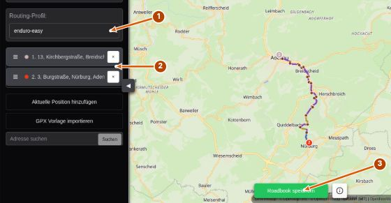](images/planning.jpg)

_1: Profil auswählen. 2: Start und Ziel kontrollieren. 3: Das Roadbook erstellen und speichern._

[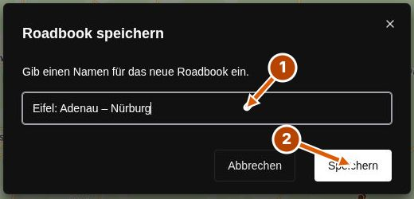](images/create.jpg)

_Das Namensfeld betrifft dein Projekt in der App. Eine Datei exportierst du später separat._

**Ergebnis:** Dein Roadbook steht in der **Routenliste** und kann über **Laden & Navigieren** geöffnet werden.

## Roadbook umbenennen

**Beispiel:** Aus „Eifel: Adenau – Nürburg“ soll „Eifel: Sonntagsrunde“ werden.

1. Öffne die **Routenplanung**.
2. Wähle unter **Roadbook auswählen** dein gespeichertes Roadbook.
3. Öffne das kleine Zahnrad **Roadbook-Aktionen** direkt neben der Auswahl.
4. Wähle **Umbenennen**.
5. Trage den neuen Namen ein und bestätige mit **Speichern**.

[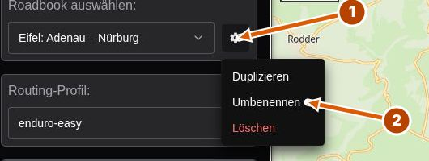](images/actions.jpg)

[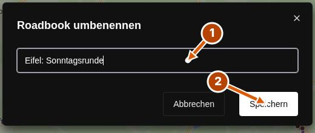](images/rename.jpg)

_Du änderst den Namen des gespeicherten Projekts. Bereits exportierte Dateien behalten ihren bisherigen Dateinamen._

## Roadbook löschen

**Beispiel:** Du brauchst eine alte Testtour nicht mehr.

Wenn du sie später vielleicht noch einmal nutzen möchtest, [exportiere vorher eine RN2-Sicherung](#roadbook-exportieren).

1. Öffne die **Routenplanung**.
2. Wähle das betreffende Roadbook.
3. Öffne das Zahnrad **Roadbook-Aktionen** neben der Auswahl.
4. Wähle **Löschen**.
5. Prüfe oben links das ausgewählte Roadbook und bestätige im Dialog die Löschung.

[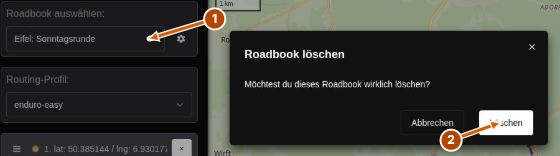](images/delete.jpg)

> Es gibt keinen Papierkorb. In der **Routenliste → Optionen → Löschen** wird das Roadbook direkt entfernt; dort erscheint derzeit kein zusätzlicher Bestätigungsdialog. Exportierte Dateien auf deinem Gerät werden dadurch nicht gelöscht.

## Roadbook exportieren

**Beispiel:** Du planst am Computer und möchtest das Roadbook auf einem anderen Gerät öffnen oder ausdrucken.

1. Öffne unten die **Routenliste** über das Listensymbol.
2. Suche dein Roadbook.
3. Klicke auf das Diskettensymbol **Speichern**. Alternativ: Zahnrad **Optionen → Export…**.
4. Wähle das passende Format.
5. Klicke auf **Export…** und warte, bis die Datei bereitsteht.
6. In der Web-Version landet die Datei im Downloadbereich deines Browsers. In der installierten App wählst du einen Speicherort.

[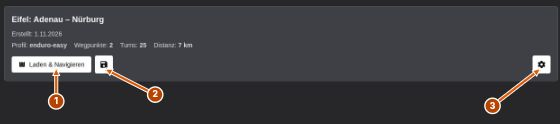](images/library.jpg)

[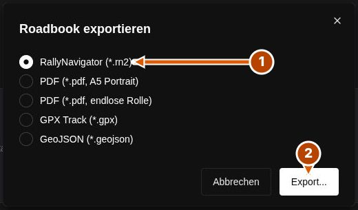](images/export.jpg)

| Ich möchte …                                                             | Format                          |
| ------------------------------------------------------------------------ | ------------------------------- |
| Das Roadbook sichern oder in RoadbookNavi auf einem anderen Gerät öffnen | **RallyNavigator (\*.rn2)**     |
| Ein Roadbook auf einzelnen Seiten ausdrucken                             | **PDF (\*.pdf, A5 Portrait)**   |
| Ein durchgehendes Roadbook für eine Papierrolle verwenden                | **PDF (\*.pdf, endlose Rolle)** |
| Die Strecke in einem anderen Karten- oder Navigationsprogramm verwenden  | **GPX Track (\*.gpx)**          |
| Die Strecke in einem Programm mit GeoJSON-Unterstützung verwenden        | **GeoJSON (\*.geojson)**        |

**RN2** enthält die Roadbook-Einträge und Zeichnungen. **GPX und GeoJSON** übertragen die Strecke, nicht das vollständige Roadbook. Eine **PDF-Datei** eignet sich zum Lesen oder Drucken.

Beim Drucken des A5-PDFs stelle die passende Papiergröße ein und prüfe die Druckvorschau. Ein Rollen-PDF braucht eine zum Drucker und zur gewünschten Rolle passende Druckeinstellung.

## App öffnen und installieren

Du kannst [RoadbookNavi direkt im Browser öffnen](https://roadbooknavi.de/app/) oder auf der [Website die installierte App herunterladen](https://roadbooknavi.de/#download).

| Gerät                         | Passender Download                                   |
| ----------------------------- | ---------------------------------------------------- |
| Windows-PC mit x64-Prozessor  | Windows-Installer **.exe**                           |
| Mac mit Apple Silicon         | macOS-Abbild **.dmg**                                |
| Linux-PC mit x86_64-Prozessor | **.AppImage** oder für Debian/Ubuntu **.deb**        |
| Android-Gerät mit ARM64       | Android-Paket **.apk**                               |
| iPhone oder iPad              | Web-Version im Browser; es gibt keine native iOS-App |

Öffne die heruntergeladene Datei und folge dem Installationsablauf deines Betriebssystems. Auf dem Mac ziehst du die App aus dem geöffneten DMG in **Programme**. Für ein AppImage unter Linux muss die Datei ausführbar sein. Auf Android führt das Öffnen der APK durch die Installation.

**Web oder installierte App?** Die Bedienung ist weitgehend gleich. Im Browser brauchst du für neue Routen Internet. Die installierte App kann Routen mit bereits geladenen Gebietsdaten ohne Verbindung berechnen. Plane die erste Tour zu Hause mit Verbindung.

## In der App zurechtfinden

Die Symbole unten bleiben erreichbar:

| Symbol       | Hier findest du …                                              |
| ------------ | -------------------------------------------------------------- |
| Buch         | **Roadbook** zum Lesen und Navigieren                          |
| Karte        | **Routenplanung** mit Wegpunkten und Profilen                  |
| Liste        | **Routenliste** mit gespeicherten Roadbooks, Import und Export |
| Zahnrad      | **Einstellungen** für Anzeige und Bedienung                    |
| Fragezeichen | Diese **Hilfe**                                                |

Über **Zur App zurück** in der Hilfenavigation kehrst du zur vorherigen Ansicht zurück. Das Nachlesen in der Hilfe setzt deinen Odometer nicht zurück.

In der Roadbook-Ansicht erscheinen links zwei zusätzliche Schalter: das **Standort-Symbol für Auto-Follow** und das **Lineal-Symbol zum Ein- und Ausblenden des Odometer-Bereichs**.

## Wegpunkte und Strecke anpassen

### Punkte auf der Karte setzen

Klicke oder tippe an die gewünschte Stelle. Der erste Punkt ist dein Start, der letzte dein Ziel. Mindestens zwei Punkte sind erforderlich.

Neue Punkte können passend in einen vorhandenen Streckenabschnitt eingefügt werden. Kontrolliere danach die nummerierte Liste links: Die Nummern bestimmen die Reihenfolge.

### Punkte verschieben oder entfernen

- **Verschieben:** Ziehe einen Marker auf der Karte an die neue Position.
- **Entfernen:** Klicke auf einen Marker oder auf das **×** neben dem Punkt in der Liste.
- **Reihenfolge ändern:** Ziehe einen Punkt am Griff links in der Liste nach oben oder unten.
- **Zwischenpunkt einfügen:** Klicke auf die vorhandene Route.
- **Verlauf verändern:** Ziehe einen Abschnitt der Route an die gewünschte Stelle. Dadurch entsteht ein weiterer Wegpunkt.

[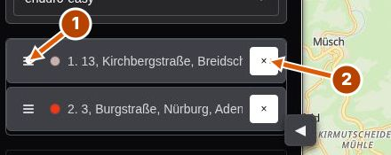](images/waypoints.jpg)

Die Route wird nach einer Änderung neu berechnet. Ein einfacher Klick auf einen vorhandenen Marker entfernt ihn; zum Verschieben musst du ihn ziehen.

### Eine gespeicherte Route anpassen

Wähle sie in der Routenplanung aus oder öffne in der Routenliste **Optionen → Bearbeiten**. Ändere die Wegpunkte oder das Profil und bestätige mit **Änderungen speichern**. Solange Änderungen offen sind, kannst du sie über den roten **X-Button** neben dem grünen Speicherbutton verwerfen.

Das betrifft den Verlauf der Route. Ein eigener Zeichen- oder Texteditor für einzelne Tulip-Diagramme und Hinweise steht nicht zur Verfügung.

### Eine Variante anlegen

Wähle in der Routenplanung ein Roadbook und öffne **Roadbook-Aktionen → Duplizieren**. Du erhältst ein weiteres Projekt für eine Routenvariante. Für die vollständige Sicherung eines importierten RN2-Roadbooks verwende den RN2-Export.

## Orte suchen und den Standort verwenden

1. Gib mindestens drei Zeichen in die Adresssuche ein, zum Beispiel **Adenau**.
2. Drücke **Enter** oder klicke auf **Suchen**.
3. Wähle den passenden Treffer. Er wird als Wegpunkt übernommen.

Die Suche startet erst nach deiner Bestätigung, nicht schon beim Tippen.

[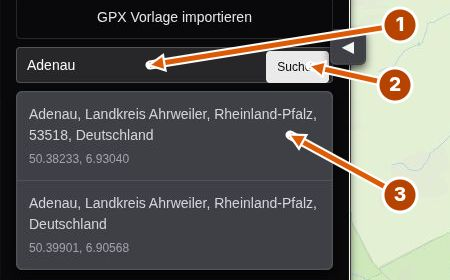](images/search.jpg)

**Aktuelle Position hinzufügen** setzt einen Wegpunkt an deinen Standort. Das Standort-Symbol rechts auf der Karte verschiebt dagegen den Kartenausschnitt zu deiner Position. Für beides muss dein Gerät einen Standort liefern und die Freigabe dafür erteilt sein.

Die Adresssuche benötigt eine Verbindung und eine aktivierte **Online-Ortssuche**. Ohne Suche kannst du Punkte weiterhin direkt auf der Karte setzen.

## Routingprofil und Karte wählen

Ein Routingprofil entscheidet, wie die App deine Wegpunkte verbindet. Es ändert keine bereits auf Papier gedruckten Roadbooks.

In der Web-Version findest du **trekking** sowie die mitgelieferten Enduro-Profile **enduro-easy**, **enduro-medium**, **enduro-hard**, **enduro** und **enduro_new**. Die Auswahl in der installierten App kann zusätzliche mitgelieferte BRouter-Profile enthalten.

Beginne mit einem Profil, prüfe den berechneten Verlauf und vergleiche bei Bedarf ein zweites. Die Profilnamen sind keine verlässliche Zusage zur Befahrbarkeit oder zum tatsächlichen Schwierigkeitsgrad. Eigene Profil-Dateien kannst du in der Oberfläche nicht hinzufügen.

Über das Kartensymbol rechts wechselst du zwischen **Liberty**, **Bright**, **Positron**, **Dark**, **Fiord**, **Liberty 3D** und **Natural Earth · Relief**. Der Kartenstil verändert die Darstellung, nicht die berechnete Route. Die Reliefkarte dient dem groben Überblick.

[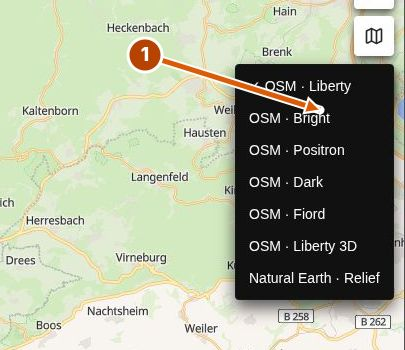](images/map.jpg)

**+ / −** verändern den Zoom. Das Kompasssymbol richtet die Karte nach Norden aus. In **Einstellungen → App** kannst du einen Standard-Kartenstil und ein Standard-Routingprofil wählen.

## Streckenlänge und Untergrund prüfen

Öffne den **Details-Button (i)** neben dem grünen Speicherbutton. Du siehst die Länge, den geschätzten Offroad-Anteil und die Längen der erkannten Oberflächen. Die Streckenfarben auf der Karte entsprechen diesen Oberflächen.

[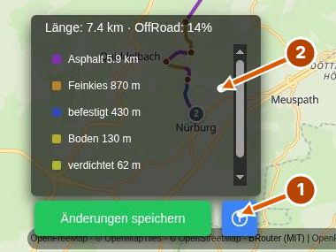](images/analysis.jpg)

Die Angaben beruhen auf den verfügbaren Kartendaten. Bei fehlenden Angaben schätzt die App den Untergrund anhand weiterer Wegmerkmale. **„Unbekannt“ bedeutet nicht „Offroad“.** Prüfe wichtige Abschnitte vor deiner Tour zusätzlich.

## Eine GPX-Vorlage verwenden

**Beispiel:** Du hast von jemandem einen GPX-Track für eine Eifel-Tour bekommen und möchtest daraus ein Roadbook erstellen.

1. Öffne **Routenplanung → Neues Roadbook**.
2. Klicke auf **GPX Vorlage importieren**.
3. Wähle die **.gpx**-Datei.
4. Vergleiche den eingeblendeten Originaltrack mit der neu berechneten Route.
5. Wähle ein passendes Profil und ergänze oder verschiebe Punkte, wo die Route anders verlaufen soll.
6. Klicke auf **Roadbook speichern**, vergib einen Namen und bestätige.

[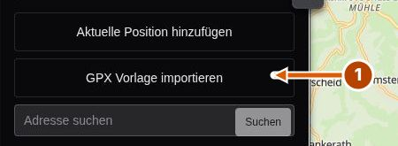](images/gpx.jpg)

> Die GPX-Datei ist eine Vorlage. Die App vereinfacht den Track, übernimmt daraus Wegpunkte und berechnet deren Verbindung neu. Deshalb kann das Roadbook vom ursprünglichen Track abweichen. Kontrolliere den Verlauf vor dem Speichern.

GPX-Vorlagen öffnest du im **Routenplaner**. Der Button **Öffnen (.rn2)** in der Routenliste ist für RN2-Roadbooks vorgesehen.

## Ein erhaltenes Roadbook öffnen

1. Speichere die erhaltene **.rn2**-Datei auf deinem Gerät.
2. Öffne in RoadbookNavi die **Routenliste**.
3. Klicke auf **Öffnen (.rn2)** und wähle die Datei.
4. Lies die Hinweise im Importdialog und bestätige den Import.
5. Das Roadbook erscheint als eigenes Projekt. Öffne es über **Laden & Navigieren**.

[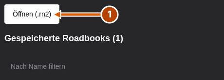](images/import.jpg)

RN2-Dateien der Version 4 werden unterstützt. Bekannte Symbole und eingebettete Bilder werden übernommen. Nicht verfügbare Symbole können als Name oder Ersatzdarstellung erscheinen. Verweise auf externe Bilder werden nicht nachgeladen.

**Vor einer Fahrt mit dem Original abgleichen:** Manuelle RN2-Distanzkorrekturen und Smart Tags werden derzeit nicht ausgewertet. Die angezeigten Entfernungen stammen aus dem GPS-Track.

Unveränderte Originalzeichnungen bleiben beim RN2-Austausch erhalten. Wenn du den Verlauf einer importierten Route änderst, können betroffene Kreuzungszeichnungen neu erzeugt werden. Exportiere vorher eine RN2-Sicherung und bewahre die erhaltene Originaldatei auf.

## Ein Roadbook lesen

Ein Roadbook beschreibt die Strecke als Folge von Einträgen. Lies sie der Reihe nach.

[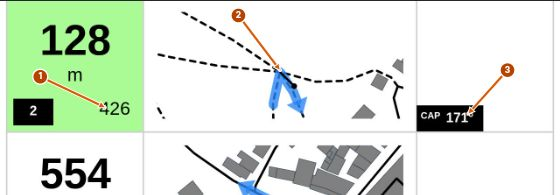](images/roadbook.jpg)

- **Eintragsnummer:** Verbindet die Zeichnung mit der Nummer in der Navigationsanzeige.
- **Gesamtdistanz:** Entfernung dieses Eintrags vom Start.
- **Kleine Distanzzahl unten rechts:** Abstand zum nächsten Eintrag. Beispiel: 128 m Gesamtdistanz plus 426 m bis zum nächsten Eintrag ergibt dessen Gesamtdistanz von 554 m.
- **Tulip-Zeichnung:** Schematische Darstellung der Kreuzung. Der Punkt markiert die Anfahrt; der Pfeil zeigt die Ausfahrt. Die Zeichnung ist kein nach Norden ausgerichteter Kartenausschnitt.
- **CAP im Eintrag:** Geplante Richtung an dieser Stelle in Grad. Sie ist von der aktuellen Richtung im umschaltbaren Navigationsfeld zu unterscheiden.
- **Hinweise und Symbole:** Zusätzliche Informationen zu diesem Eintrag. Bei importierten Roadbooks stammen sie aus der Datei.

**Beispiel:** Dein Odometer zeigt 2,30 km. Der nächste Eintrag liegt bei 2,50 km. Bis zu seiner Roadbook-Distanz fehlen ungefähr 200 m. Die Entfernung im Navigationsfeld kann davon abweichen, weil dieses die direkte Entfernung zum Zielpunkt anzeigt.

## Eine Fahrt vorbereiten

1. Öffne das gewünschte Roadbook über **Routenliste → Laden & Navigieren**.
2. Warte, bis das Roadbook vollständig sichtbar ist.
3. Erlaube den Standortzugriff und prüfe, ob Koordinaten angezeigt werden.
4. Kontrolliere am Start, ob der Odometer zum Roadbook passt.
5. Schalte nach Bedarf **Auto-Follow** ein.
6. Prüfe die Bedienung mit Touch, Tastatur oder deiner Lenkersteuerung vor der Abfahrt.
7. Wenn du ohne Internet fahren möchtest, führe vorher den [Offline-Check](#ohne-internet-unterwegs) durch.

Die App fragt den Standort bereits beim Öffnen ab. Du musst nicht erst einen separaten „Navigation starten“-Button drücken. Beim erneuten Öffnen eines Roadbooks aus der Liste oder beim Wechsel zu einem anderen Roadbook beginnt der Odometer wieder bei null.

Bleibe während der Fahrt in der geöffneten App. Bei gesperrtem Bildschirm, im Hintergrund oder bei fehlendem Standortsignal ist die zuverlässige Fortführung nicht garantiert. Nimm Einstellungen und Korrekturen an einem geeigneten Haltepunkt vor.

## Odometer einstellen und korrigieren

Der **Odometer** zählt die zurückgelegte Strecke. Er zeigt unter 1 km Meter, danach Kilometer. Während der Bewegung erhöht ihn die App anhand des Standorts.

[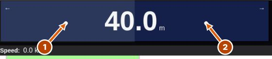](images/odometer.jpg)

- **Linke Hälfte antippen:** 10 m abziehen.
- **Rechte Hälfte antippen:** 10 m hinzufügen.
- **Gedrückt halten:** Den Wert fortlaufend verändern.
- **Tastatur:** Standardmäßig **←** zum Verringern und **→** zum Erhöhen.

**Beispiel:** An einem eindeutig erkennbaren Roadbook-Eintrag stehen 3,20 km. Dein Odometer zeigt 3,16 km. Tippe viermal rechts auf die Anzeige, um 40 m hinzuzufügen.

Wenn die Anzeige nicht zu sehen ist, blende sie unten über das **Lineal-Symbol** ein. In **Einstellungen → Benutzeroberfläche → Odometer-Position** wählst du **Automatisch**, **Links** oder **Oben**.

## Auto-Follow und Blättern

Das **Standort-Symbol links unten** schaltet Auto-Follow ein und aus. Im eingeschalteten Zustand folgt das Roadbook dem Odometer und springt zum anstehenden Eintrag. Eine Odometer-Korrektur verändert deshalb auch, welcher Eintrag angesteuert wird.

[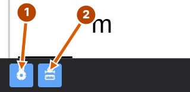](images/follow.jpg)

Wenn du selbst vor- oder zurückblättern möchtest, **schalte Auto-Follow über dieses Symbol aus**. Du kannst dann mit Touch, dem Mausrad oder den eingerichteten Scrolltasten blättern.

In **Einstellungen → App** gibt es zwei Scrollmodi:

- **Schrittweise (Einträge):** **↑ / ↓** springt zum vorherigen oder nächsten Eintrag.
- **Kontinuierlich:** Halte die Scrolltaste für eine gleichmäßige Bewegung. Die Geschwindigkeit stellst du darunter ein.

Schalte Auto-Follow wieder über das Standort-Symbol ein, wenn das Roadbook erneut dem Odometer folgen soll.

## Die Navigationsanzeige wechseln

Tippe auf das Informationsfeld neben beziehungsweise unter dem Odometer. Jeder Tipp wechselt zur nächsten Ansicht:

1. **Nächster Eintrag:** Nummer, direkte Entfernung zum Zielpunkt und Richtungspfeil.
2. **Geschwindigkeit:** Aktueller Wert in km/h, sofern das Gerät ihn liefert.
3. **GPS:** Breitengrad und Längengrad.
4. **Finish:** Direkte Entfernung und Richtung zum Ziel des Roadbooks.
5. **Nordpfeil:** Richtung nach Norden.
6. **CAP:** Aktuelle Bewegungs- beziehungsweise Kompassrichtung in Grad.

[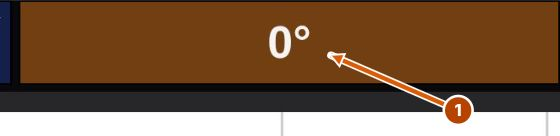](images/dashboard.jpg)

**Direkte Entfernung ist Luftlinie.** Die Entfernung im Feld „Nächster Eintrag“ oder „Finish“ ist nicht die verbleibende Strecke entlang der Route. Die Zielauswahl orientiert sich am Roadbook und am Odometer. Bei einer Abweichung von der Strecke musst du den Verlauf und gegebenenfalls den Odometer selbst abgleichen; die Anzeige ersetzt keine neue Routenplanung.

Ohne verwertbare Standortdaten können einzelne Felder leer bleiben oder **—** zeigen. Die Richtungsanzeige hängt davon ab, welche Standort- und Kompassdaten dein Gerät bereitstellt.

## Tastatur und Lenkersteuerung einrichten

Eine Lenkersteuerung kann verwendet werden, wenn sie sich deinem Gerät gegenüber wie eine Tastatur verhält.

1. Verbinde die Steuerung mit deinem Gerät.
2. Öffne **Einstellungen → App**.
3. Klicke bei **Odometer verringern**, **Odometer erhöhen**, **Roadbook nach oben** oder **Roadbook nach unten** auf die angezeigte Taste.
4. Drücke die gewünschte Taste an der Tastatur oder Steuerung.
5. Verwende verschiedene Tasten für die verschiedenen Aktionen.
6. Öffne das Roadbook und teste die Belegung im Stand.

[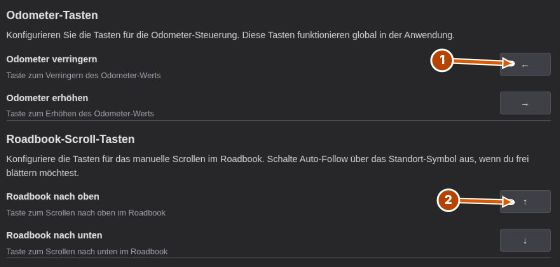](images/keys.jpg)

Standard: **← / →** für den Odometer, **↑ / ↓** zum Blättern. Einzelne Tasten werden unterstützt; Tastenkombinationen mit Strg, Alt, Umschalt oder Cmd sind dafür nicht vorgesehen. Für Auto-Follow verwende den Standort-Schalter in der Roadbook-Ansicht.

## Darstellung und Einstellungen anpassen

Unter **Einstellungen → Benutzeroberfläche** findest du:

- **Design-Modus:** Hell, Dunkel oder System.
- **Sprache:** Deutsch oder Englisch.
- **Odometer-Position:** Automatisch je nach Ausrichtung, immer links oder immer oben.

[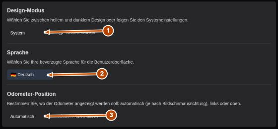](images/appearance.jpg)

Unter **Einstellungen → App** findest du unter anderem **Bildschirm aktiv halten**, Standardkarte, Standardprofil, Tasten, Scrollmodus und Scrollgeschwindigkeit. Die Bildschirmaktivierung hängt von der Unterstützung deines Geräts beziehungsweise Browsers ab.

Die **Nahbereichsschwelle** lässt sich zwischen **100 und 1000 m** einstellen. Beachte: Die grünen Distanzfelder im aktuellen PDF markieren Abstände von höchstens **200 m zum vorherigen Eintrag**. Diese PDF-Markierung verwendet derzeit immer 200 m und ändert sich durch den Regler nicht. Ein Pfeil im Distanzfeld kündigt einen entsprechend nahen nächsten Eintrag an.

[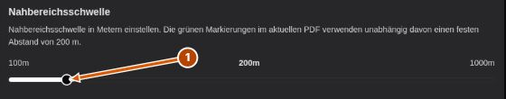](images/threshold.jpg)

### Online-Ortssuche

Unter **Einstellungen → App → Online-Ortssuche** kannst du die Ortssuche ein- oder ausschalten. Wenn du einen anderen passenden Suchdienst verwendest, trage seine **Nominatim-Dienst-URL** und gegebenenfalls deinen eigenen API-Key ein. Über **Verbindung testen** prüfst du, ob der Dienst antwortet.

[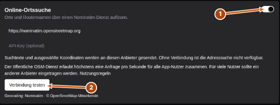](images/search-settings.jpg)

Ohne Online-Ortssuche werden Punkte weiterhin über die Karte gesetzt; automatische Ortsnamen können dann durch Koordinaten ersetzt sein.

## Roadbooks wiederfinden und sichern

In der **Routenliste** kannst du nach Namen filtern und nach Datum, Name oder Länge sortieren. Das Datum steht für die letzte Änderung. Bei unbekannter Länge steht ein Roadbook am Ende der Längensortierung.

Gespeicherte Roadbooks bleiben auf diesem Gerät. In der Web-Version sind sie zusätzlich an genau diesen Browser und diese Website gebunden. Ein Link zu einer Roadbook-Ansicht überträgt das Projekt nicht auf ein anderes Gerät.

**Regelmäßig sichern:** Exportiere wichtige Roadbooks als **RN2**. Bewahre die Dateien an einem zweiten Ort auf, zum Beispiel in deiner eigenen Dateisicherung. Private Browserfenster und das Löschen der Website-Daten können Web-Projekte entfernen. Auch beim Entfernen von App-Daten oder beim Gerätewechsel solltest du dich auf deine RN2-Sicherungen verlassen.

## Ein Roadbook auf ein anderes Gerät mitnehmen

**Beispiel:** Du planst am Laptop und fährst mit dem Android-Handy.

1. Exportiere am Laptop das fertige Roadbook als **RN2**.
2. Übertrage die Datei mit deiner bevorzugten Methode auf das Handy, etwa per Dateitransfer oder über deinen eigenen Speicher.
3. Öffne RoadbookNavi auf dem Handy.
4. Importiere die Datei über **Routenliste → Öffnen (.rn2)**.
5. Öffne das Roadbook einmal über **Laden & Navigieren**.
6. Führe vor der Tour den Offline-Check durch.

Es gibt kein Konto und keine automatische Synchronisierung. Spätere Änderungen am Laptop werden erst nach einem erneuten Dateiexport und Import auf dem anderen Gerät verfügbar.

## Ohne Internet unterwegs

| Was möchtest du tun?                              | Web-Version                              | Installierte App                                     |
| ------------------------------------------------- | ---------------------------------------- | ---------------------------------------------------- |
| Ein bereits erzeugtes Roadbook ansehen            | Bei geöffneter und geladener App möglich | Mit lokal vorhandenem Roadbook möglich               |
| Die App ohne Verbindung neu starten               | Nicht unterstützt                        | Möglich                                              |
| Neue Strecken berechnen                           | Benötigt Internet                        | Mit passenden bereits geladenen Routingdaten möglich |
| Neue Kreuzungsbilder erzeugen                     | Fehlende Daten benötigen Internet        | Fehlende Daten benötigen Internet                    |
| Die Planungskarte neu laden oder neue Orte suchen | Benötigt Internet                        | Benötigt Internet                                    |

### Offline-Check vor der Tour

1. Erstelle oder importiere das Roadbook zu Hause mit Verbindung.
2. Öffne es über **Laden & Navigieren**.
3. Blättere durch die Einträge und prüfe, ob die Zeichnungen sichtbar sind.
4. Trenne testweise die Internetverbindung. Lasse bei der Web-Version die App geöffnet.
5. Kontrolliere Roadbook-Anzeige, Blättern und Standortzugriff.
6. Stelle vor der Abfahrt die gewünschte Verbindung wieder her oder bleibe nach erfolgreichem Test offline.

Die installierte App lädt fehlende Gebietsdaten beim Berechnen automatisch und verwendet sie später wieder. Eine gespeicherte Route ist keine Garantie, dass jede beliebige neue Strecke in der Umgebung offline berechnet werden kann.

## Speicher aufräumen und App zurücksetzen

Unter **Einstellungen → App** gibt es unterschiedliche Aktionen:

[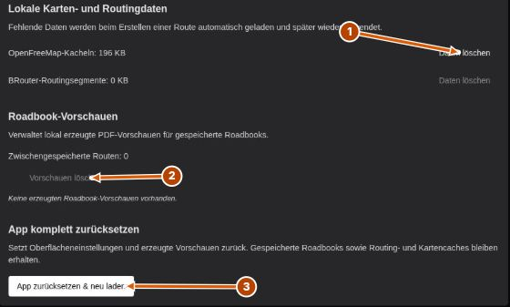](images/storage.jpg)

| Aktion                                      | Was passiert?                                                                                                                                                         |
| ------------------------------------------- | --------------------------------------------------------------------------------------------------------------------------------------------------------------------- |
| **OpenFreeMap-Kacheln → Daten löschen**     | Geladene Daten für Kreuzungsbilder werden entfernt. Bei Bedarf ist ein erneuter Download nötig.                                                                       |
| **BRouter-Routingsegmente → Daten löschen** | Lokal geladene Routingdaten werden entfernt. Neue native Berechnungen können wieder Internet benötigen. In der Web-Version werden keine solchen Segmente gespeichert. |
| **Vorschauen löschen**                      | Erzeugte PDF-Vorschauen werden entfernt. Die Roadbook-Projekte bleiben erhalten; ihre Anzeige muss erneut vorbereitet werden.                                         |
| **App zurücksetzen & neu laden**            | Einstellungen und Vorschauen werden zurückgesetzt. Gespeicherte Projekte sowie Karten- und Routingdaten bleiben erhalten.                                             |
| **Roadbook löschen**                        | Entfernt das betreffende Projekt. Für eine spätere Wiederherstellung brauchst du eine exportierte Datei.                                                              |

Lösche Daten möglichst zu Hause mit Verbindung, damit die App benötigte Inhalte wieder laden kann. **Browser-Website-Daten löschen** ist etwas anderes als der Zurücksetzen-Button in der App: Dabei können auch deine gespeicherten Web-Roadbooks verloren gehen.

## Updates und Unterstützung

In der installierten App öffnest du **Einstellungen → Über → Nach Updates suchen**. Bei einer neuen Version führt **Neue Version laden** zur Downloadseite. Lade das passende Installationspaket und installiere das Update; der Button installiert es nicht automatisch.

Die Web-Version aktualisierst du durch Neuladen bei bestehender Verbindung. Exportiere wichtige Roadbooks vorher als RN2-Sicherung.

Wenn du einen Fehler meldest, notiere Gerät, Betriebssystem, Browser beziehungsweise App-Version und die Schritte bis zum Problem. Die angezeigte Version findest du unter **Einstellungen → Über**. Über die [GitHub-Issues](https://github.com/pcace/RoadbookNavi/issues) kannst du Fehler melden oder Vorschläge machen. Entferne persönliche Daten aus Screenshots oder Dateien, die du öffentlich hochlädst.

## Probleme lösen

### Ich bekomme keinen Standort

Prüfe die Standortfreigabe für die App beziehungsweise Website und die Standortfunktion deines Geräts. Verwende im Web die HTTPS-Adresse von RoadbookNavi. Versuche es mit freier Sicht zum Himmel und lasse die App im Vordergrund. Ein Desktop-Rechner liefert unter Umständen keinen brauchbaren GPS-Standort.

Eine Meldung wie **Zugriff verweigert** deutet auf die Freigabe hin; **Timeout** oder **Position nicht verfügbar** kann auf ein fehlendes Signal hinweisen. Die Karte und gespeicherte Roadbooks lassen sich unabhängig davon ansehen.

### Der Odometer passt nicht zum Roadbook

Vergleiche ihn im Stand an einem eindeutig erkennbaren Eintrag und korrigiere ihn über die linke oder rechte Hälfte. Prüfe nach einem Roadbook-Wechsel erneut den Startwert. Bei längeren Standortausfällen kann eine manuelle Korrektur nötig sein.

### Auto-Follow zeigt den falschen Eintrag

Kontrolliere zuerst den Odometer. Schalte Auto-Follow aus, blättere zum passenden Eintrag und gleiche die Roadbook-Distanz ab. Korrigiere den Odometer und schalte Auto-Follow wieder ein.

### Die Suche findet keinen Ort

Bestätige die Suche mit **Enter** oder **Suchen**. Prüfe Internet und **Einstellungen → App → Online-Ortssuche → Verbindung testen**. Verwende einen eindeutigeren Ortsnamen. Alternativ setzt du die Punkte auf der Karte.

### Die Route wird nicht berechnet

Prüfe, ob mindestens zwei Wegpunkte gesetzt sind und die Punkte an passenden Wegen liegen. Versetze einen problematischen Punkt etwas oder probiere ein anderes mitgeliefertes Profil. Im Browser brauchst du Internet; in der installierten App müssen fehlende Gebietsdaten zuerst heruntergeladen werden.

### Das Roadbook bleibt leer oder meldet einen PDF-Fehler

Warte zunächst, bis die Erstellung abgeschlossen ist. Öffne das gespeicherte Roadbook erneut aus der Routenliste. Wenn das nicht hilft, lösche unter **Einstellungen → App** nur die **Roadbook-Vorschauen** und öffne es mit Verbindung erneut. Sichere wichtige Projekte als RN2, bevor du weitergehende Schritte ausprobierst.

### Meine Route ist auf dem anderen Gerät nicht da

Die Bibliotheken werden nicht synchronisiert. Exportiere auf dem ursprünglichen Gerät eine RN2-Datei und importiere sie auf dem zweiten Gerät. Ein kopierter Link reicht nicht aus.

### Ich finde meine exportierte Datei nicht

Prüfe die Downloads deines Browsers beziehungsweise den beim Speichern gewählten Ordner. „Roadbook speichern“ im Planer legt ein Projekt in der App an; erst der Export aus der Routenliste erzeugt eine Datei.

## Welche Daten bleiben bei mir?

Deine Projekte bleiben lokal. Es gibt kein RoadbookNavi-Konto und keine automatische Übertragung deiner Bibliothek.

- **Web-Routenberechnung:** Die Wegpunkte und das gewählte Profil werden an brouter.de gesendet.
- **Installierte App:** Die Route wird auf dem Gerät berechnet. Fehlende Gebietsdaten und Kreuzungsdaten werden heruntergeladen.
- **Karte und Kreuzungsdaten:** Die App lädt benötigte Inhalte von OpenFreeMap.
- **Online-Ortssuche:** Suchtexte und Koordinaten werden an den eingestellten Suchanbieter geschickt. Du kannst die Funktion ausschalten.

**Anleitung auf anderen Wegen:** [English](en.md) · [Markdown auf GitHub](https://github.com/pcace/RoadbookNavi/blob/main/public/help/de.md) · [RoadbookNavi-Website](https://roadbooknavi.de/)

_Stand: 1. November 2026. Die Abbildungen zeigen die deutsche Web-Oberfläche; die wichtigsten Bedienelemente sind in der installierten App an denselben Stellen._
